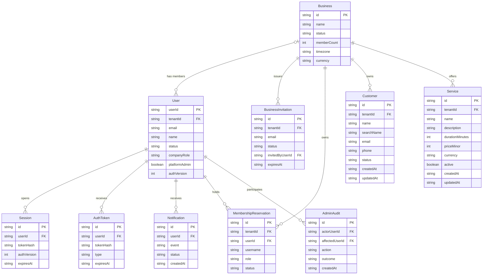

# Data Architecture & Persistence Layer

BookSimple persists 14 authentication, company-control and operational record
types plus Customer and Service business domains in Azure Cosmos DB for NoSQL
through the TypeScript SDK without an ORM. Future business domains use
separately approved containers.

## Database Configuration

| Service/Module | DB Type | Profile | Driver | Connection | Migration Tool |
| --- | --- | --- | --- | --- | --- |
| Authentication and company control | Azure Cosmos DB for NoSQL | Local development | Azure Cosmos JavaScript SDK | Environment-supplied HTTPS endpoint using a local key or Azure CLI identity | Reviewed TypeScript provisioning and migration scripts |
| Authentication and company control | Azure Cosmos DB for NoSQL | Vercel production target | Azure Cosmos JavaScript SDK | Environment-supplied HTTPS endpoint using Vercel OIDC and Microsoft Entra ID | Reviewed TypeScript provisioning and migration scripts |
| Customer domain | Azure Cosmos DB for NoSQL | Local and Vercel targets | Azure Cosmos JavaScript SDK | Existing singleton Cosmos client and dedicated `customers` container | Reviewed TypeScript provisioning script |
| Service domain | Azure Cosmos DB for NoSQL | Local and Vercel targets | Azure Cosmos JavaScript SDK | Existing singleton Cosmos client and dedicated `services` container | Reviewed TypeScript provisioning script |

Authentication containers are provisioned with TTL enabled and no default
expiry. Each expiring document declares its own retention. No seed data or ORM
schema generation is used.

## Data Ownership per Service

| Service | Tables Owned | ORM Framework | Caching | Notes |
| --- | --- | --- | --- | --- |
| Account and authorization | User, EmailIndex, AuthToken, Session, RateLimit | None; direct Cosmos SDK | None | Owns identity and sign-in state |
| Business setup | Business, BusinessInvitation, MembershipReservation | None; direct Cosmos SDK | None | Business records use business ID partitions |
| Notification delivery | Notification | None; direct Cosmos SDK | None | Encrypted payload exists only while pending or failed |
| Platform administration | AdminAudit, DeletedUserTombstone, BootstrapLock | None; direct Cosmos SDK | None | Audit and security-control records |
| Customer management | Customer | None; direct Cosmos SDK | None | Dedicated `/tenantId` container with no default TTL |
| Service management | Service | None; direct Cosmos SDK | None | Dedicated `/tenantId` container with no default TTL |

## Entity Model

<!-- mermaid-checked: every attribute is `<type> <name> [<key>] ["<description>"]` with at most one of PK/FK/UK, no \n in descriptions, no {} in descriptions, every relationship label is double-quoted -->

EmailIndex, RateLimit, DeletedUserTombstone and BootstrapLock are technical
control records omitted from the relationship diagram to keep it readable.

## Key Repository Methods

| Service | Repository | Notable Methods | Purpose |
| --- | --- | --- | --- |
| Shared Cosmos persistence | `auth-storage.ts` | `readDocument`, `createDocument`, `replaceDocument`, `deleteDocument`, `commitBatch`, `queryPage`, `queryAllPages` | Typed point reads, optimistic writes, transactional partition batches and bounded queries |
| Authentication | `auth.ts` and `auth-service.ts` | `resolveSessionToken`, `createSession`, `runAuthAction`, `runAdminAction`, `listAdminData` | Account, session and administration persistence |
| Tenant resolution | `tenant-context.ts` | `resolveTenantContext`, tenant guards | Resolves company ownership from server-validated membership |
| Business setup | `business-service.ts` | `getBusinessSetup`, `updateBusinessSettings`, invitation operations | Tenant-scoped business and invitation persistence |
| Customer management | `customer-storage.ts` and `customer-service.ts` | `queryCustomerPage`, `getCustomer`, `createCustomer`, `updateCustomer`, `archiveCustomer`, `eraseCustomer` | Single-partition pagination, point reads, ETag writes, duplicate warnings and lifecycle operations |
| Service management | `service-storage.ts` and `service-service.ts` | `queryServicePage`, `getService`, `createService`, `updateService`, `setServiceActive` | Single-partition pagination, point reads, ETag writes and active lifecycle operations |
| Retention governance | `data-retention.ts` and `migrate-data-retention.ts` | `retentionSecondsFor` and dry-run migration | Central retention mapping and controlled migration |

## Caching Strategy

No application data cache is configured. The application performs Cosmos point
reads or bounded queries directly and reuses a singleton Cosmos client. Session
documents are persistent authentication state, not a cache. No query-result,
second-level or distributed cache is currently justified by measured traffic.

## Data Ownership Boundaries

All current records share one Cosmos database but are separated into
authentication control, sessions, throttling, Customer and Service containers.
`auth-control` co-locates related account and business-control records for
point reads and same-partition transactions; it is not approved for Customers,
Bookings, Messages or Payments.

Tenant-owned operations resolve the active Business on the server. Company
records use the Business GUID as their logical partition. Account records use a
deterministic hash of normalized email so related account control records can be
updated transactionally without storing the email in the partition key.

The approved Customer container uses `/tenantId`, aligning the partition with
all Stage 6 list, search, point-read and write operations. Duplicate customer
email and phone values remain allowed; duplicate warnings are application
guidance rather than database uniqueness constraints.

The implemented Service container also uses `/tenantId`. Prices use safe
integer minor units with explicit currency, and inactive records remain durable
so future Booking references can retain stable Service IDs.

### Data Classification & Sensitivity

| Entity | Sensitive Fields | Classification | Controls in Place |
| --- | --- | --- | --- |
| User | Name, email, password hash, roles | PII and security | Server authorization, password hashing, anonymized deletion, no raw password |
| Business | Name, timezone, currency | Business data; possible PII in name | Tenant authorization and partition scoping |
| BusinessInvitation | Invitee email | PII | Tenant-admin authorization, hashed secret, TTL |
| Session | Hashed verifier, user ID | Security | Hashed verifier, TTL, revocation and authorization version |
| AuthToken | Hashed token, user ID | Security | Hashed token, short TTL and one-time use |
| Notification | Encrypted email payload while pending or failed | PII | Field encryption, payload removal after send and TTL |
| MembershipReservation | Internal username, user ID and role | Security metadata | Tenant partition, server-only access and released-record TTL |
| AdminAudit | Actor and affected identifiers | Security metadata | Server-only writes and one-year TTL |
| DeletedUserTombstone | Former user ID and timestamps | Pseudonymous identifier | Name and email removed; one-year TTL |
| Customer | Name, email and phone | PII | Server-resolved tenant partition, archive, admin-only anonymization and no PCI or PHI |
| Service | Name, description, duration and price | Business data; possible incidental PII in free text | Server-resolved tenant partition, no payment-card data and durable deactivation |
| RateLimit | Hashed scope and count | None directly | Hashed keys and short TTL |
| BootstrapLock | User ID and setup-token hash | Security | Hashed setup token and permanent single-use control |

No payment-card data or health data is currently stored. Azure Cosmos DB
provides encryption at rest; notification payloads additionally use
application-level encryption while delivery is pending or failed.
