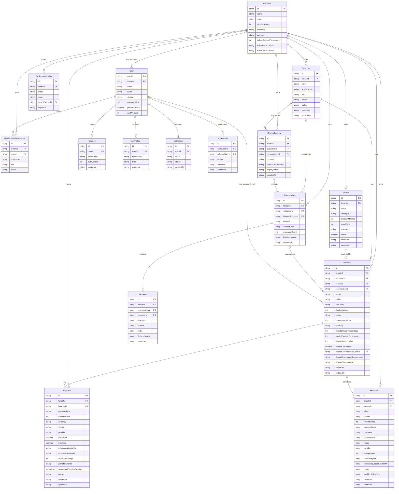

# Data Architecture & Persistence Layer

BookSimple persists authentication, company-control and operational records
plus Customer, Service, Conversation, Booking, Payment and Reminder business domains in Azure
Cosmos DB for NoSQL through the TypeScript SDK without an ORM. Future business
domains use separately approved containers.

## Database Configuration

| Service/Module | DB Type | Profile | Driver | Connection | Migration Tool |
| --- | --- | --- | --- | --- | --- |
| Authentication and company control | Azure Cosmos DB for NoSQL | Local development | Azure Cosmos JavaScript SDK | Environment-supplied HTTPS endpoint using a local key or Azure CLI identity | Reviewed TypeScript provisioning and migration scripts |
| Authentication and company control | Azure Cosmos DB for NoSQL | Vercel production target | Azure Cosmos JavaScript SDK | Environment-supplied HTTPS endpoint using Vercel OIDC and Microsoft Entra ID | Reviewed TypeScript provisioning and migration scripts |
| Customer domain | Azure Cosmos DB for NoSQL | Local and Vercel targets | Azure Cosmos JavaScript SDK | Existing singleton Cosmos client and dedicated `customers` container | Reviewed TypeScript provisioning script |
| Service domain | Azure Cosmos DB for NoSQL | Local and Vercel targets | Azure Cosmos JavaScript SDK | Existing singleton Cosmos client and dedicated `services` container | Reviewed TypeScript provisioning script |
| Conversation domain | Azure Cosmos DB for NoSQL | Local and Vercel targets | Azure Cosmos JavaScript SDK | Singleton client with hierarchical `conversations` and tenant-partitioned `channel-identities` containers | Reviewed TypeScript provisioning script |
| Booking domain | Azure Cosmos DB for NoSQL | Local and Vercel targets | Azure Cosmos JavaScript SDK | Existing singleton Cosmos client and dedicated `bookings` container | Reviewed TypeScript provisioning script |
| Payment domain | Azure Cosmos DB for NoSQL | Local and Vercel targets | Azure Cosmos JavaScript SDK | Existing singleton Cosmos client and dedicated `payments` container | Reviewed TypeScript provisioning script |
| Reminder domain | Azure Cosmos DB for NoSQL | Local and Vercel targets | Azure Cosmos JavaScript SDK | Existing singleton Cosmos client and dedicated `reminders` container | Reviewed TypeScript provisioning script and server-side worker |

Authentication containers are provisioned with TTL enabled and no default
expiry. Each expiring document declares its own retention. No seed data or ORM
schema generation is used.

## Data Ownership per Service

| Service | Tables Owned | ORM Framework | Caching | Notes |
| --- | --- | --- | --- | --- |
| Account and authorization | User, EmailIndex, AuthToken, Session, RateLimit | None; direct Cosmos SDK | None | Owns identity and sign-in state |
| Business setup | Business, BusinessInvitation, MembershipReservation | None; direct Cosmos SDK | None | Business records use business ID partitions and retain separate non-secret Stripe test and live account references |
| Notification delivery | Notification | None; direct Cosmos SDK | None | Encrypted payload exists only while pending or failed |
| Platform administration | AdminAudit, DeletedUserTombstone, BootstrapLock | None; direct Cosmos SDK | None | Audit and security-control records |
| Customer management | Customer | None; direct Cosmos SDK | None | Dedicated `/tenantId` container with no default TTL |
| Service management | Service | None; direct Cosmos SDK | None | Dedicated `/tenantId` container with no default TTL |
| Conversation management | Conversation, Message, ChannelIdentity | None; direct Cosmos SDK | None | Conversation and Message share `/tenantId`, `/conversationId`; identities use `/tenantId` |
| Booking management | Booking | None; direct Cosmos SDK | None | Dedicated `/tenantId` container with UTC instants and Service snapshots |
| Payment management | Payment | None; direct Cosmos SDK | None | Dedicated `/tenantId` container with mock or Stripe Checkout references and no card data |
| Reminder management | Reminder | None; direct Cosmos SDK | None | Dedicated `/tenantId` container with UTC schedules, ETag claims, processing leases and mock delivery results |

## Entity Model

<!-- mermaid-checked: every attribute is `<type> <name> [<key>] ["<description>"]` with at most one of PK/FK/UK, no \n in descriptions, no {} in descriptions, every relationship label is double-quoted -->

EmailIndex, RateLimit, DeletedUserTombstone and BootstrapLock are technical
control records omitted from the relationship diagram to keep it readable.

## Key Repository Methods

| Service | Repository | Notable Methods | Purpose |
| --- | --- | --- | --- |
| Shared Cosmos persistence | `auth-storage.ts` | `readDocument`, `createDocument`, `replaceDocument`, `deleteDocument`, `commitBatch`, `queryPage`, `queryAllPages` | Typed point reads, optimistic writes, transactional partition batches and bounded queries |
| Authentication | `auth.ts` and `auth-service.ts` | `resolveSessionToken`, `createSession`, `runAuthAction`, `runAdminAction`, `listAdminData` | Account, session and administration persistence |
| Tenant resolution | `tenant-context.ts` | `resolveTenantContext`, tenant guards | Resolves company ownership from server-validated membership |
| Business setup | `business-service.ts` and `stripe-connect-service.ts` | `getBusinessSetup`, `updateBusinessSettings`, `getStripeConnection`, `createStripeOnboardingLink`, invitation operations | Tenant-scoped business settings, Stripe Accounts v2 references, hosted onboarding and invitations |
| Customer management | `customer-storage.ts` and `customer-service.ts` | `queryCustomerPage`, `getCustomer`, `createCustomer`, `updateCustomer`, `archiveCustomer`, `eraseCustomer` | Single-partition pagination, point reads, ETag writes, duplicate warnings and lifecycle operations |
| Service management | `service-storage.ts` and `service-service.ts` | `queryServicePage`, `getService`, `createService`, `updateService`, `setServiceActive` | Single-partition pagination, point reads, ETag writes and active lifecycle operations |
| Conversation management | `conversation-storage.ts` and `conversation-service.ts` | `queryConversationPage`, `getConversationDetailsForContext`, `createConversation`, `addConversationMessage`, `linkConversationCustomer` | Tenant-key listings, hierarchical point reads, transactional message and summary writes, exact matching and guarded Customer resolution |
| Booking management | `booking-storage.ts` and `booking-service.ts` | `queryBookingPage`, `getBooking`, `createBooking`, `updateBooking`, `setBookingStatus`, `overrideBookingDeposit` | Tenant pagination, point reads, reference validation, timezone conversion, snapshotted deposit terms, ETag edits and lifecycle status |
| Payment management | `payment-storage.ts` and `payment-service.ts` | `queryBookingPayments`, `createPayment`, `confirmMockPayment`, `processStripeWebhook` | Tenant-scoped deposit and balance Payments, hosted Checkout, signed event validation, ETag transitions and retry-safe Booking reconciliation |
| Reminder management | `reminder-storage.ts` and `reminder-service.ts` | `queryBookingReminders`, `createBookingReminders`, `rescheduleBookingReminders`, `processDueReminders` | Tenant-scoped Reminder snapshots, ETag scheduling updates, terminal cancellation and lease-based mock processing |
| Retention governance | `data-retention.ts` and `migrate-data-retention.ts` | `retentionSecondsFor` and dry-run migration | Central retention mapping and controlled migration |

## Caching Strategy

No application data cache is configured. The application performs Cosmos point
reads or bounded queries directly and reuses a singleton Cosmos client. Session
documents are persistent authentication state, not a cache. No query-result,
second-level or distributed cache is currently justified by measured traffic.

## Data Ownership Boundaries

All current records share one Cosmos database but are separated into
authentication control, sessions, throttling, Customer, Service,
Conversation, channel-identity, Booking, Payment and Reminder containers.
`auth-control` co-locates related account and business-control records for
point reads and same-partition transactions; it is not approved for Customers,
Bookings, Messages or Payments.

Tenant-owned operations resolve the active Business on the server. Company
records use the Business GUID as their logical partition. Account records use a
deterministic hash of normalized email so related account control records can be
updated transactionally without storing the email in the partition key.

The approved Customer container uses `/tenantId`, aligning the partition with
all Stage 6 list, search, point-read and write operations. Duplicate customer
email and phone values remain allowed; duplicate warnings are application
guidance rather than database uniqueness constraints.

The implemented Service container also uses `/tenantId`. Prices use safe
integer minor units with explicit currency, and inactive records remain durable
so future Booking references can retain stable Service IDs.

The `conversations` container uses hierarchical `/tenantId` and
`/conversationId` paths. Tenant listings constrain the first path through an
equality predicate, while one Conversation and its Messages use the complete
key for point reads, scoped queries and transactional batches.
`channel-identities` uses `/tenantId` and a deterministic channel-address ID
for exact point matching. Customer references are hydrated and authorized by
the service layer; cross-container linking uses ETags and compensating rollback.

The `bookings` container uses `/tenantId`. Customer, Service and optional
Conversation references are checked with tenant-scoped point reads. UTC
instants and an IANA timezone preserve scheduling semantics; Service duration,
minor-unit amount and currency snapshots prevent later Service edits from
silently rewriting existing Bookings.

The `payments` container uses `/tenantId`. Payment records reference Booking
IDs and snapshot minor-unit financial terms. The service layer validates the
Booking in the same tenant and reconciles cross-container status changes
idempotently. Stripe direct charges are scoped to the connected account and
signed events must match account, mode, Session, amount and currency; no
payment-card data is persisted.

The `reminders` container uses `/tenantId`. Business defaults create
deterministic per-Booking records with UTC schedules and retained timezone
context. Unsent records follow Booking time changes and terminal lifecycle
changes. The server-side worker performs bounded cross-partition due discovery,
then uses tenant-aware point reads, ETag claims and expiring leases before
recording mock delivery.

### Data Classification & Sensitivity

| Entity | Sensitive Fields | Classification | Controls in Place |
| --- | --- | --- | --- |
| User | Name, email, password hash, roles | PII and security | Server authorization, password hashing, anonymized deletion, no raw password |
| Business | Name, timezone, currency and Stripe connected-account IDs | Business data; possible PII in name; provider identifiers | Tenant authorization, partition scoping, admin-only onboarding and no provider secrets |
| BusinessInvitation | Invitee email | PII | Tenant-admin authorization, hashed secret, TTL |
| Session | Hashed verifier, user ID | Security | Hashed verifier, TTL, revocation and authorization version |
| AuthToken | Hashed token, user ID | Security | Hashed token, short TTL and one-time use |
| Notification | Encrypted email payload while pending or failed | PII | Field encryption, payload removal after send and TTL |
| MembershipReservation | Internal username, user ID and role | Security metadata | Tenant partition, server-only access and released-record TTL |
| AdminAudit | Actor and affected identifiers | Security metadata | Server-only writes and one-year TTL |
| DeletedUserTombstone | Former user ID and timestamps | Pseudonymous identifier | Name and email removed; one-year TTL |
| Customer | Name, email and phone | PII | Server-resolved tenant partition, archive, admin-only anonymization and no PCI or PHI |
| Service | Name, description, duration and price | Business data; possible incidental PII in free text | Server-resolved tenant partition, no payment-card data and durable deactivation |
| ChannelIdentity | Normalized email, phone or provider-neutral address; display label | PII | Deterministic ID, server-resolved tenant partition and no provider credentials |
| Conversation | Contact label, optional Customer ID and last-message preview | PII and communication metadata | Hierarchical tenant partition, bounded preview, server authorization and Cosmos encryption at rest |
| Message | Message body, direction, channel and optional Customer ID | PII and sensitive communication content | Full tenant and Conversation partition key, 4,000-character limit, server authorization and Cosmos encryption at rest |
| Booking | Customer, Service and optional Conversation IDs; times, amount, currency, deposit terms, overriding user and status | Pseudonymous Customer activity and business transaction data | Server-resolved tenant partition, same-tenant reference checks, no copied Customer contact data and Cosmos encryption at rest |
| Payment | Booking ID, amount, currency, status, connected-account ID, Checkout Session ID and event IDs | Financial transaction metadata; no PCI card data | Server-resolved tenant partition, provider adapter, signed webhooks, mode and account validation, idempotent identifiers, ETags and Cosmos encryption at rest |
| Reminder | Booking ID, schedule, timezone, channel and processing history | Pseudonymous Customer activity and communication metadata | Server-resolved tenant partition, authenticated Booking reads, ETag claims, processing leases, no message body and Cosmos encryption at rest |
| RateLimit | Hashed scope and count | None directly | Hashed keys and short TTL |
| BootstrapLock | User ID and setup-token hash | Security | Hashed setup token and permanent single-use control |

No payment-card data or health data is currently stored. Azure Cosmos DB
provides encryption at rest; notification payloads additionally use
application-level encryption while delivery is pending or failed.
